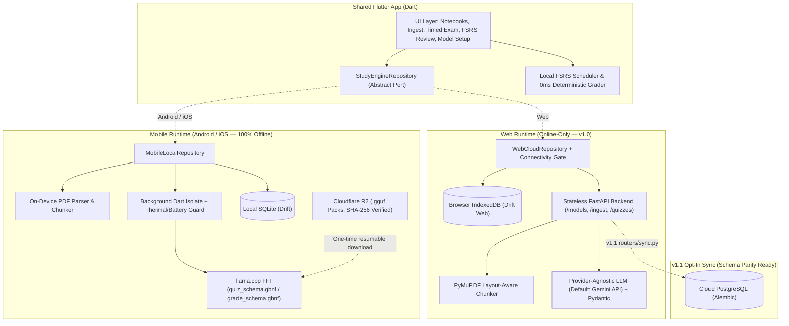

# TalaAral — Technical Design Specification

> **Version**: 1.4 (Repository Port Completed, Review Progress Lifecycle Locked)
> **Architectural Goal**: Deliver **TalaAral**, a single-codebase study platform that turns lecture PDFs and class notes into a durable per-Notebook **Question Bank**, timed practice exams, and FSRS spaced-repetition queues. The installed Android/iOS app runs **100% offline** using native on-device AI (`llama.cpp` via Dart FFI) and local SQLite (`drift`), while the hosted web version runs **online-only** using a stateless Python (`FastAPI`) backend for high-accuracy PDF parsing and Cloud LLM generation/grading, paired with browser-local persistence (`IndexedDB` via Drift Web) in v1.0.
>
> **Vocabulary**: Domain terms (Notebook, Document, Source Chunk, Question Bank, Generation, Quiz Session, Study Mode, Quiz Attempt, Answer Score, Rating, Review Progress, Model Pack) are defined in [GLOSSARY.md](../GLOSSARY.md). Use them exactly; avoid the listed synonyms (e.g. never "deck").

### Changelog

- **v1.4**: Review Progress is created at a Question's first Rating, and only Timed Exams bring never-reviewed Questions into review ([ADR-0001](./adr/0001-review-progress-starts-at-first-rating.md)) (§2.4). Quiz Session completion and `score_pct` defined; incomplete sessions and unanswered Questions (§2.3.3). Port completed: Notebook management, reactive list streams, Question deletion, `completeQuizSession`, session-checked `recordReview`, `AiAvailability`; mobile-only `ModelPackManager` (§3.3, §3.4). New `quiz_session_questions` table; `notebooks.subject` is nullable; Question-deletion cascade (§3.1, §3.2).
- **v1.3**: Questions persist in a per-Notebook Question Bank and Quiz Sessions draw from it (§2.1.5, §2.3.1). Per-chunk question allocation and duplicate rejection (§2.1.6). Single Answer Score drives `is_correct` and FSRS Ratings; Practice never updates FSRS (§2.4). Cloze `accepted_answers` (§2.2). Schema sync columns completed, `documents.filename` → `title`, nullable page fields for notes, partial unique index on `content_hash`, soft-delete cascade (§3). Repository port split into Generation vs. Quiz Session operations (§3.3). New generation quality evaluation gate (§5).

---

## 1. System Overview & Dual-Runtime Architecture

A shared **Flutter (Dart)** frontend powers both the hosted website and the installable Android/iOS apps. All persistence, document ingestion, and AI inference calls route through a runtime-agnostic repository interface (`StudyEngineRepository`), which binds to either `WebCloudRepository` or `MobileLocalRepository` depending on the target platform.

### Runtime Comparison Matrix

| Architectural Layer | Web Runtime (Online-Only, v1.0) | Mobile Runtime (Android / iOS Offline) |
|---|---|---|
| **Frontend UI** | Shared Flutter Web bundle | Shared Flutter compiled to native ARM code |
| **Repository Binding** | `WebCloudRepository` | `MobileLocalRepository` |
| **AI Inference Engine** | Cloud LLM via provider-agnostic FastAPI service (default: **Google Gemini 2.5 Flash-Lite / Flash**) + Pydantic v2 validation + **Cloudflare Turnstile** anti-abuse gate | Native `llama.cpp` via Dart FFI (`llama_cpp_dart`) on **Metal (iOS)** and **`arm64-v8a` CPU (`ARM NEON`/`dotprod`) default + opt-in/guarded Vulkan fallback (Android)** |
| **PDF & Notes Extraction** | `PyMuPDF` (`fitz`) layout-aware parser on FastAPI backend | On-device PDF text extraction via platform `MethodChannel` (`talaaral/mobile_pdf_extractor`: **iOS `PDFKit`** + **Android `PdfBox-Android`**) + equivalent Dart sentence chunker |
| **Database & Storage** | Browser `IndexedDB` via Drift Web (zero auth required in v1.0); Alembic PostgreSQL schema kept in parity for v1.1 sync | Local SQLite (`drift`) |
| **Offline Behavior** | Disabled for generation/grading; locks AI actions and displays mobile app download banner | 100% functional offline after one-time `.gguf` model pack download |

### Key Design Decisions

1. **Sub-500 MB Store Installer (Option B Packaging)**:
   - The Flutter release binary (Android AAB / iOS IPA) plus the compiled `llama.cpp` native library remains **~30–40 MB** (hard ceiling: `< 500 MB`, target `< 45 MB`).
   - Zero model weights (`.gguf`) are ever bundled inside the app binary.
2. **Tiered Offline Model Packs (Cloudflare R2 — `Qwen2.5-Instruct` Family)**:
   - On first launch, mobile users download a verified quantized `.gguf` pack from Cloudflare R2 (zero egress fees), standardized on **Apache 2.0 `Qwen2.5-Instruct` (ChatML)** for reliable GBNF JSON decoding inside `n_ctx: 2048` without `<think>` token overhead:
     - **Lite Pack**: `~420 MB` (`Qwen2.5-0.5B-Instruct`, `Q4_K_M`) — auto-recommended for devices with `< 6 GB` RAM.
     - **Standard Pack**: `~950 MB` (`Qwen2.5-1.5B-Instruct`, `Q4_K_M`) — auto-recommended for modern devices with `>= 6 GB` RAM.
   - Every pack must pass the generation quality evaluation gate (§5) before it is published to the manifest.
   - **Mobile Native Packaging**: Android targets **`arm64-v8a` only** (avoiding 32-bit virtual address space OOMs on large `mmap` weights) with **CPU (`ARM NEON`/`dotprod`)** as the stable default and opt-in/guarded Vulkan fallback; iOS uses **Metal**.
   - **OS-Compliant Storage**: Packs are stored in iOS `Application Support` with `NSURLIsExcludedFromBackupKey` set (preventing iCloud backup bloat / App Store rejection) and Android app-private files storage.
   - Downloads require a `1.5x` free disk space pre-check, stream to a `.part` file with HTTP `Range` resume support, and verify SHA-256 before atomic rename and setting `isModelReady = true`.
3. **Native Speed & Web Accuracy Split**:
   - Dart FFI eliminates JavaScript WebView bridge overhead so local token generation runs at native C++/GPU speeds inside a background Dart `Isolate` (keeping UI at 60/120 FPS).
   - Web leverages Python (`PyMuPDF` + `Pydantic v2` + Gemini API) for high-accuracy multi-column parsing and structured output validation.
4. **Stateless Web v1.0 with v1.1 Sync Parity**:
   - v1.0 Web avoids premature auth complexity by storing notebooks, chunks, questions, and FSRS state in the browser (`Drift Web / IndexedDB`) while FastAPI serves stateless ingestion, generation, and grading endpoints.
   - Identical Drift & Alembic PostgreSQL schemas with client-generated **UUIDv7** keys and soft-delete tombstones make v1.1 opt-in sync seamless.

---

## 2. Core Data Flow & Offline AI Pipeline

Small on-device language models lose accuracy when given entire 40-page slide decks at once. The ingestion, generation, and grading pipeline enforces strict chunking, grammar-constrained decoding, and hardware guardrails.

### 2.1 Ingestion & Generation

1. **Supported Inputs**: Text-based PDFs (`.pdf`) and plain-text / Markdown class notes (`ingestPdf`, `ingestNotes`). Each becomes one **Document** with a `title` (the PDF filename, or the user-supplied notes title).
2. **Scanned-PDF Guardrail (v1.0 — No OCR)**: Both web and mobile measure extracted text density. If a PDF yields `< 20` non-whitespace characters per page on average, ingestion fails fast with a clear user-facing error (`SCANNED_PDF_UNSUPPORTED`: *"This PDF appears to be scanned or image-only. Please upload a text-based PDF or paste your notes."*).
3. **Reading-Order Extraction & Cleaning**:
   - Web (`PyMuPDF` / `fitz`): Extracts blocks in natural reading order across multi-column slides, tables, and code blocks; strips repeated headers/footers.
   - Mobile: On-device PDF extractor via platform `MethodChannel` (`talaaral/mobile_pdf_extractor`: native iOS `PDFKit` and Android `PdfBox-Android`) feeds into a shared Dart chunker matching backend rules.
4. **Chunking Strategy**: Split on sentence boundaries into **250–350 word chunks** with a **30-word overlap**, recording `chunk_index`, `word_count`, and — for PDFs only — `page_start` / `page_end` (null for notes).
5. **Decoupled Ingest → Generation → Quiz Session Flow**:
   - Uploading a PDF performs fast chunking immediately (`< 2s`) without blocking on LLM inference.
   - **Generation** produces new Questions from selected Source Chunks and adds them to the Notebook's durable **Question Bank**. It runs sequentially across chunks with per-chunk Drift checkpoints (§2.5).
   - A **Quiz Session** draws Questions from the Question Bank (§2.3.1) and triggers Generation only for any shortfall. Questions are reused across sessions; they are never regenerated per quiz.
6. **Per-Chunk Question Allocation**:
   - A request for `N` Questions over a set of selected chunks is distributed **proportionally to each chunk's `word_count`**, capped at **3 Questions per chunk per Generation call** (keeps chunk + prompt + JSON output within `n_ctx: 2048`).
   - If `N > 3 × selected chunk count`, Generation does not overload chunks: the UI reports that the scope is too small and offers the maximum achievable count instead.
7. **Duplicate Rejection**:
   - Before checkpointing, each newly generated Question is compared against existing non-deleted Questions in the same Notebook whose chunk is the **same or adjacent** (`chunk_index ± 1` within the same Document) — this catches both the 30-word overlap and repeated Generation runs.
   - Similarity: normalized prompt (lowercased, punctuation stripped, whitespace collapsed), token-set **Jaccard ≥ 0.8** → duplicate, discarded (never persisted).
   - Discarded slots trigger **one** retry Generation call for that chunk. If the retry still yields duplicates, the shortfall is **accepted** — no further retries — and reported in `GenerationProgress`.

### 2.2 Grammar-Constrained JSON Generation & Grading

- Every mobile `llama.cpp` call runs inside a dedicated **background Dart `Isolate`** with `n_ctx: 2048`, ChatML prompt formatting (`Qwen2.5-Instruct`), hardware acceleration flags (**Metal** on iOS, **`arm64-v8a` CPU `ARM NEON`/`dotprod` default** with opt-in/guarded Vulkan fallback on Android), and tuned sampling (`temperature`, `repeat_penalty`, `max_tokens`).
- **Two distinct GBNF grammars** are bundled in `app/assets/grammars/`:
  1. `quiz_schema.gbnf`: Constrains Generation to valid JSON arrays of `{type, prompt, options, correct_answer, explanation}` (plus `accepted_answers` for `cloze`) without conversational filler.
  2. `grade_schema.gbnf`: Constrains short-answer & code-trace grading to `{score, is_correct, feedback, missing_concepts}`. The model's `is_correct` is **advisory only**; the persisted value is derived from `score` (§2.4).
- **Answer fields**:
  - `correct_answer` is the **Canonical Answer** — the single answer displayed to the student.
  - For `cloze` only, `options_json` stores `{"accepted_answers": [...]}`: additional correct variants. Grading checks `correct_answer` **and** `accepted_answers`, so `accepted_answers` must not duplicate `correct_answer`.
- **Memory & Idle Unload**: Load weights via `mmap`; automatically unload the `llama.cpp` context after an idle timeout (e.g., 60 seconds after leaving generation/grading screens) or on OS memory-pressure warnings to avoid iOS Jetsam termination.

### 2.3 Quiz Sessions & Grading

#### 2.3.1 Question Selection

| Study Mode | Candidate Questions | Ordering | Shortfall |
|---|---|---|---|
| `timed_exam` / `practice` | Non-deleted Questions in the selected scope (Documents / page range) and allowed Question Types | Never-attempted first, then least-recently attempted | Triggers Generation for the missing count (§2.1.6) |
| `srs_review` | All due Questions in the Notebook (`next_review_at <= now`), regardless of scope | Most overdue first | Never triggers Generation |

#### 2.3.2 Hybrid Grading

- **Deterministic Grading (`0 ms` latency, pure Dart)**: `mcq`, `true_false`, and `cloze` grade locally on both Web and Mobile. Cloze matches case/whitespace-normalized input against `correct_answer` and `accepted_answers`.
- **AI Semantic Grading**: `short_answer` and `code_trace` invoke the local SLM (`grade_schema.gbnf`) on Mobile or `POST /api/v1/quizzes/grade` on Web, grounded strictly against the Question's `SourceChunk.raw_text`.
- **Timed Exam AI Grading (Batch on Submit)**: In `timed_exam` mode, submitting stops the countdown clock immediately, displays `0 ms` deterministic scores right away, and batch-grades `short_answer`/`code_trace` items sequentially with progress (and retry support if Web briefly drops offline). `completeQuizSession` is called once all Quiz Attempts are recorded.

#### 2.3.3 Session Completion

- `startQuizSession` records the drawn Questions, in order, in `quiz_session_questions`.
- `completeQuizSession` sets `completed_at` and `score_pct` = mean Answer Score over **all drawn Questions** × 100, with unanswered Questions counting as `0`.
- **Unanswered Questions** (e.g. the Timed Exam clock ran out) have no Quiz Attempt and receive **no Rating**.
- **Incomplete sessions** (never completed: app killed, abandoned) cannot be resumed in v1.0, never apply Ratings, and are excluded from session history and stats. Quiz Attempts and SRS Review Ratings already recorded in them are kept. Starting a new session leaves an incomplete one as it is.
- **Question deleted mid-session**: the open session keeps it and it stays answerable; its Quiz Attempt is recorded and counts toward `score_pct`, but no Rating is applied.

### 2.4 Answer Score & FSRS Coupling

- **Single Answer Score** (`0.0–1.0`) for every Quiz Attempt:
  - Deterministic types: exactly `1.0` (correct) or `0.0` (incorrect).
  - AI-graded types: the grader's `score`.
- **`is_correct` is derived**, never taken from the model: `is_correct = answer_score >= 0.7`.
- **Score → Rating mapping** (non-overlapping):

  | Answer Score | Rating |
  |---|---|
  | `< 0.7` | `Again` |
  | `0.7 ≤ score < 0.85` | `Hard` |
  | `≥ 0.85` | `Good` |

  `Easy` is never assigned automatically.
- **Review Progress lifecycle** ([ADR-0001](./adr/0001-review-progress-starts-at-first-rating.md)): a Question has **no** `review_progress` row until its first Rating, when the row is created. A Timed Exam is the only way a never-reviewed Question gets that first Rating. SRS Review only shows Questions that are already due, and its empty state points the student to a Timed Exam.
- **Mode-Aware FSRS Coupling** (enforced inside the port, not the UI):
  - `timed_exam`: `completeQuizSession` applies the mapped Rating for each answered Question in one transaction, without interrupting exam flow.
  - `srs_review`: After grading reveals the explanation / AI feedback, pre-highlights the mapped Rating and lets the student confirm `Again / Hard / Good / Easy` in one tap.
  - `practice`: **Never updates Review Progress.** Quiz Attempts are still recorded. (Rationale: repeated same-evening drilling would inflate FSRS intervals.)
  - Questions with no Quiz Attempt (unanswered) and Questions deleted mid-session receive no Rating in any mode.

### 2.5 Thermal, Battery & Checkpointing Guardrails (Mobile)

- Generation processes chunks **sequentially** on the background isolate.
- After each chunk finishes (including duplicate rejection, §2.1.7), accepted Questions are immediately persisted to Drift SQLite (**per-chunk checkpointing**) so interrupted jobs resume from the last incomplete chunk.
- Platform hooks monitor battery level (e.g., pause below 15% unless charging) and OS thermal state (iOS `ProcessInfo.thermalState` / Android `PowerManager.getCurrentThermalStatus`), pausing Generation gracefully with a resume prompt if the device overheats.

---

## 3. Shared Data Model & Repository Contract

Maintaining identical table structures across **Drift SQLite** (Mobile + Web IndexedDB) and **Alembic PostgreSQL** (v1.1 cloud sync) guarantees conflict-free synchronization.

- **Primary Keys**: Client-generated **UUIDv7** (time-ordered, globally unique offline). `review_progress` uses its `question_id` (itself a UUIDv7) as PK — one row per Question.
- **Sync Readiness**: All mutable tables include `created_at`, `updated_at` (UTC ISO-8601 / timestamp) and nullable `deleted_at` (soft-delete tombstone).
- **Append-Only Exemption**: `quiz_attempts` and `quiz_session_questions` rows are immutable once written, so they carry only `created_at` (no `updated_at` / `deleted_at`).

### 3.1 Database Schema (8 Tables)

| Table Name | Columns & Keys | Purpose |
|---|---|---|
| `notebooks` | `id (UUIDv7 PK)`, `owner_id (UUID nullable)`, `title`, `subject (nullable)`, `created_at`, `updated_at`, `deleted_at` | Top-level container for a course or exam topic. |
| `documents` | `id (UUIDv7 PK)`, `notebook_id (FK)`, `title`, `source_type (pdf\|markdown\|text)`, `content_hash (SHA-256)`, `page_count (nullable — null for notes)`, `status (pending\|chunked\|failed)`, `created_at`, `updated_at`, `deleted_at` | Tracks ingested PDFs/notes per Notebook, prevents duplicate uploads, and enables single-Document deletion. |
| `source_chunks` | `id (UUIDv7 PK)`, `document_id (FK)`, `notebook_id (FK)`, `chunk_index`, `page_start (nullable)`, `page_end (nullable)`, `word_count`, `raw_text`, `topic_label`, `created_at`, `updated_at`, `deleted_at` | 250–350 word overlapping lecture segments used as grounding context and citation references. |
| `questions` | `id (UUIDv7 PK)`, `chunk_id (FK)`, `notebook_id (FK)`, `type (mcq\|true_false\|cloze\|short_answer\|code_trace)`, `prompt`, `options_json` (MCQ options; `{"accepted_answers": [...]}` for cloze), `correct_answer` (Canonical Answer), `explanation`, `created_at`, `updated_at`, `deleted_at` | The Notebook's durable Question Bank across all 5 Question Types. |
| `review_progress` | `question_id (UUIDv7 PK/FK)`, `state (new\|learning\|review\|relearning)`, `stability (REAL)`, `difficulty (REAL)`, `reps (INT)`, `lapses (INT)`, `scheduled_days (INT)`, `last_review_at`, `next_review_at`, `last_rating (1..4)`, `created_at`, `updated_at`, `deleted_at` | Pure **FSRS** spaced-repetition memory state (replaces legacy SM-2 fields). Created at a Question's first Rating, never at Generation. |
| `quiz_sessions` | `id (UUIDv7 PK)`, `notebook_id (FK)`, `mode (timed_exam\|practice\|srs_review)`, `time_limit_sec (nullable)`, `started_at`, `completed_at`, `score_pct`, `created_at`, `updated_at`, `deleted_at` | Tracks Timed Exam, Practice, and SRS Review sittings. |
| `quiz_session_questions` | `session_id (FK)`, `question_id (FK)`, `position (INT)`, `created_at`; PK `(session_id, position)` | **Append-only** record of the Questions drawn for a Quiz Session, in order. Lets unanswered Questions count toward `score_pct` (and allows resuming sessions later). |
| `quiz_attempts` | `id (UUIDv7 PK)`, `session_id (FK)`, `question_id (FK)`, `user_answer`, `answer_score (REAL)`, `is_correct (BOOL, derived: answer_score >= 0.7)`, `ai_feedback (TEXT nullable)`, `time_spent_ms (INT)`, `created_at` | **Append-only** per-Question responses, timing, and AI grading feedback. |

**Indexes & constraints**:
- `documents`: partial unique index on `(notebook_id, content_hash) WHERE deleted_at IS NULL` — blocks duplicate active uploads within a Notebook while allowing a soft-deleted file to be re-uploaded, and the same file to exist in different Notebooks. Implemented identically in Drift (custom `CREATE UNIQUE INDEX … WHERE`) and Alembic.

### 3.2 Soft-Delete Cascade

- **Deleting a Document** soft-deletes (sets `deleted_at` on) the Document and all its `source_chunks`, `questions`, and their `review_progress` rows, in one transaction.
- `quiz_sessions`, `quiz_session_questions` and `quiz_attempts` are **retained** so score history survives; they keep referencing the tombstoned Questions.
- **Deleting a single Question** soft-deletes the Question and its `review_progress` row; its session rows and Quiz Attempts are retained.
- Re-uploading a file with the same `content_hash` after deletion creates a **new** Document (new UUIDv7) — tombstones are never resurrected.
- **Deleting a Notebook** applies the same cascade to all of its Documents and soft-deletes its `quiz_sessions`.

### 3.3 `StudyEngineRepository` Abstract Port

All UI and feature code interacts exclusively with `StudyEngineRepository` (never directly with `llama_cpp_dart` or HTTP clients). Commands and snapshots return `Future`s; lists and counts return reactive `Stream`s (Drift `watch`, supported on both Drift native and Drift Web). Notebook, list, deletion, and completion operations share one Drift-backed implementation across both adapters.

**Notebooks**
- `Future<Notebook> createNotebook({required String title, String? subject})`
- `Future<Notebook> updateNotebook({required String notebookId, String? title, String? subject})`
- `Future<void> deleteNotebook({required String notebookId})` — applies the §3.2 Notebook cascade.
- `Stream<List<NotebookSummary>> watchNotebookSummaries()` — per Notebook: title, subject, and counts of non-deleted Documents, non-deleted Questions, and Questions due now.

**Lists**
- `Stream<List<Document>> watchDocuments({required String notebookId})` — non-deleted Documents with `status`.
- `Stream<List<Question>> watchQuestions({required String notebookId, QuestionFilter? filter})` — the Question Bank, filterable by Documents and Question Types; each Question carries its Source Chunk reference (page range for PDFs).
- `Stream<List<QuizSession>> watchQuizSessions({required String notebookId})` — **completed** sessions only, newest first, with mode, dates, and `score_pct`.

**Ingestion**
- `Future<IngestResult> ingestPdf({required String notebookId, required String filename, required Uint8List bytes})`
- `Future<IngestResult> ingestNotes({required String notebookId, required String title, required String rawText})`
- `Future<void> deleteDocument({required String documentId})` — applies the §3.2 cascade.

**Question Bank**
- `Future<void> deleteQuestion({required String questionId})` — applies the §3.2 single-Question cascade. Questions are never edited in v1.0.

**Generation & Quiz Sessions**
- `Stream<GenerationProgress> generateQuestions({required String notebookId, required List<String> chunkIds, required GenerationConfig config})` — adds Questions to the Question Bank using §2.1.6–2.1.7; progress reports accepted, duplicate-rejected, and shortfall counts.
- `Future<QuizSession> startQuizSession({required String notebookId, required QuizConfig config})` — selects Questions per §2.3.1 (`QuizConfig`: mode, count, scope, allowed Question Types, time limit) and invokes Generation for any shortfall in `timed_exam` / `practice`. Records the drawn Questions in `quiz_session_questions`.
- `Future<QuizSession> completeQuizSession({required String sessionId})` — sets `completed_at` and `score_pct` (§2.3.3); for `timed_exam`, applies the mapped Rating to every answered, non-deleted Question in the same transaction.

**Grading & Recording**
- `Future<GradeResult> gradeOpenAnswer({required Question question, required SourceChunk chunk, required String userAnswer})` — AI grading for `short_answer` and `code_trace`.
- `Future<QuizAttempt> recordAttempt({required String sessionId, required String questionId, required String userAnswer, required double answerScore, String? aiFeedback, required int timeSpentMs})` — called in **every** Study Mode; derives `is_correct`.
- `Future<ReviewProgress> recordReview({required String sessionId, required String questionId, required FsrsRating rating, required DateTime reviewedAt})` — the student's confirmed Rating in `srs_review`. **Rejects any session whose mode is not `srs_review`** (Timed Exam Ratings are applied by `completeQuizSession`; Practice never rates). Creates the `review_progress` row on a Question's first Rating.
- `Future<List<Question>> getDueReviews({required String notebookId, DateTime? asOf})` — due Questions for `srs_review` (snapshot).

**AI Availability**
- `Stream<AiAvailability> watchAiAvailability()` — whether Generation and AI grading can run now. Web: `ready | offline | rateLimited`. Mobile: `noModelPack | downloading | ready | pausedThermal | pausedBattery`. Screens lock AI actions from this stream.

### 3.4 `ModelPackManager` (Mobile Only)

Model Packs don't exist on Web, so they stay off the runtime-agnostic port. A mobile-only `ModelPackManager`, used only by the Model Setup screen and never imported from web-reachable code, owns:
- the Model Pack catalog (from `GET /api/v1/models/manifest`) and the RAM-based Lite/Standard recommendation;
- download with the 1.5× free-space pre-check, `.part` + HTTP `Range` resume, SHA-256 verification, and atomic rename;
- deleting or switching the installed pack.

Its state feeds `MobileLocalRepository`'s `watchAiAvailability()`.

---

## 4. Python (FastAPI) Web Backend Modules & API Contract

The online-only web backend stays stateless in v1.0, focused on accurate PDF parsing, provider-agnostic Cloud LLM orchestration, and offline model-pack manifest distribution. Duplicate rejection, Question selection, and FSRS all run client-side in shared Dart; the backend only generates and grades.

| Module | Core Responsibility | Key Libraries |
|---|---|---|
| `app/main.py` | App bootstrap, CORS config, global error handlers, `GET /health`, rate limiter middleware | `FastAPI`, `slowapi` |
| `app/routers/models.py` | `GET /api/v1/models/manifest` — returns versioned `.gguf` catalog, Cloudflare R2 URLs, sizes, min RAM, and SHA-256 checksums | `FastAPI`, `Pydantic v2` |
| `app/routers/ingest.py` | `POST /api/v1/ingest` — validates PDF upload (max 20 MB, max 100 pages, `%PDF-` magic bytes) or raw notes, invokes chunker | `FastAPI`, `python-multipart` |
| `app/services/pdf_parser.py` | Layout-aware extraction in reading order, header/footer stripping, scanned-PDF guardrail, 250–350 word overlapping chunker | `PyMuPDF` (`fitz`) |
| `app/services/llm_provider.py` | Provider-agnostic async LLM interface (`LLMProvider`) with **Google Gemini 2.5 Flash-Lite / Flash** default implementation configured via env vars | `google-genai` / `httpx` |
| `app/services/quiz_generator.py` | Structured Generation (≤ 3 Questions per chunk, `accepted_answers` for cloze) & open-answer grading with Pydantic v2 validation and automatic **retry-once** recovery on malformed JSON | `Pydantic v2`, `LLMProvider` |
| `app/routers/quizzes.py` | `POST /api/v1/quizzes/generate` & `POST /api/v1/quizzes/grade` (IP rate-limited via `slowapi`, chunk/token-capped, and protected by **Cloudflare Turnstile** verification) | `FastAPI`, `slowapi`, `httpx` |
| `alembic/versions/001_init_schema.py` | PostgreSQL schema parity migrations (ready for v1.1 opt-in sync), including the partial unique index on `documents` and the `quiz_session_questions` table | `SQLAlchemy`, `Alembic` |
| `app/routers/sync.py` *(v1.1)* | Optional authenticated Notebook & FSRS progress sync between mobile Drift SQLite and Cloud PostgreSQL | `SQLAlchemy`, `Alembic` |

---

## 5. Generation Quality Evaluation Gate

Every Model Pack (Lite, Standard) and every Cloud LLM default change must pass this gate before release.

- **Fixture set**: ~10 real, text-based lecture PDFs spanning subjects and layouts (multi-column slides, tables, code), checked into the repo with their expected chunking.
- **Automated checks per generated Question**:
  1. **Schema validity**: parses against `quiz_schema.gbnf` / Pydantic model; correct fields for its Question Type.
  2. **Grounding** — the answer is supported by its Source Chunk:
     - `cloze` and `mcq`: normalized (case/punctuation/whitespace) **substring match** of the Canonical Answer (or any accepted answer) in `raw_text`.
     - `true_false`: not lexically checked (statements may be deliberately false); covered by manual review sampling.
     - `short_answer` and `code_trace`: **lexical overlap** of content words between the Canonical Answer and `raw_text` above a threshold; items below threshold are **flagged for manual review**, not auto-failed, so legitimate paraphrases are not penalized.
  3. **MCQ distractors**: all options distinct (normalized) and none equal to the Canonical Answer.
- **Pass criterion**: each pack must meet a minimum pass rate on automated checks, plus an acceptable manual-review outcome on flagged and sampled items. Thresholds are set per pack and recorded alongside the fixture set.

---

## 6. MVP Scope Boundaries

- **Included in v1.0**:
  - Single Flutter codebase for Web (online-only) and Android/iOS (100% offline after `.gguf` download).
  - Text-based PDF & plain-text/Markdown notes ingestion with scanned-PDF detection.
  - Durable per-Notebook Question Bank with 5 Question Types (`mcq`, `true_false`, `cloze`, `short_answer`, `code_trace`), hybrid grading, Timed Exams, Practice, and FSRS SRS Review.
  - Resumable `.gguf` pack downloader (Lite & Standard packs) with SHA-256 verification and thermal/battery guardrails.
  - Generation quality evaluation gate (§5).
- **Explicitly Deferred to v1.1+**:
  - Real-time multiplayer quizzes.
  - OCR for handwritten notes or scanned/image-only PDFs.
  - Automatic background cloud sync, user accounts/auth, and manual Notebook export/import.
  - Optional `LiteRT-LM` mobile inference adapter alongside `llama.cpp`.

---

## 7. UI/UX Direction & v1.0 Production Hosting Topology

- **UI/UX Direction (Calm Academic Editorial)**:
  - Material 3 design system with full **light & dark mode**, warm paper/slate neutrals, and a single deep indigo/teal accent.
  - High-contrast academic reading typography free of gamification clutter.
  - Responsive navigation: bottom navigation bar on mobile (`Android`/`iOS`) transitioning to a collapsible sidebar rail on desktop Web, with persistent online/offline mode indicators.
- **Production Hosting Topology (v1.0)**:
  - **Flutter Web**: Hosted on **Cloudflare Pages** (global CDN, paired with Cloudflare R2 and Turnstile).
  - **FastAPI Backend**: Stateless Docker container deployed on **Google Cloud Run** (or Fly.io) with scale-to-zero, strict `CORS_ORIGINS`, `slowapi` IP rate limiting, and Cloudflare Turnstile siteverify on `/api/v1/quizzes/*`.
  - **Offline Model Packs**: Hosted on **Cloudflare R2** (`talaaral-models`) behind a custom public domain with RFC 9110 `Range` support.
